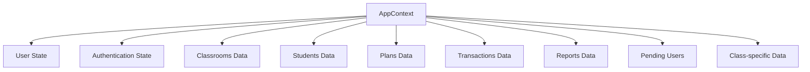

# Classroom Dashboard Frontend

[](https://dashboard-classroom.vercel.app/)

A modern, responsive classroom management dashboard built with Next.js 14 and React 19. This application provides administrators with comprehensive tools to manage students, classes, reports, transactions, and educational plans in an intuitive interface.

## 🌐 Live Demo

**[https://dashboard-classroom.vercel.app/](https://dashboard-classroom.vercel.app/)**

## 🏗️ Project Structure

```
frontend/
├── public/                 # Static assets
│   ├── images/            # Image files
│   ├── *.svg              # SVG icons
│   └── ...
├── src/
│   ├── app/               # Next.js App Router
│   │   ├── Components/    # Reusable UI components
│   │   │   ├── Classroom/ # Classroom-specific components
│   │   │   │   ├── FilesTab.jsx
│   │   │   │   ├── HomeTab.jsx
│   │   │   │   ├── NotesTab.jsx
│   │   │   │   ├── ReceivedTaskTab.jsx
│   │   │   │   ├── StudentCard.jsx
│   │   │   │   ├── StudentsTab.jsx
│   │   │   │   ├── TaskTab.jsx
│   │   │   │   └── VideosTab.jsx
│   │   │   ├── Cloudinary/ # Cloudinary upload components
│   │   │   ├── ClassroomCard.jsx
│   │   │   ├── Classrooms.jsx
│   │   │   ├── DashboardHome.jsx
│   │   │   ├── PendingUsers.jsx
│   │   │   ├── PlanCard.jsx
│   │   │   ├── Plans.jsx
│   │   │   ├── Profile.jsx
│   │   │   ├── ReportCard.jsx
│   │   │   ├── Reports.jsx
│   │   │   ├── Students.jsx
│   │   │   └── Transactions.jsx
│   │   ├── Context/       # React Context
│   │   │   └── AppContext.jsx
│   │   ├── Pages/         # Page routes
│   │   │   ├── Auth/      # Authentication pages
│   │   │   ├── ClassRoom/ # Classroom detail pages
│   │   │   ├── StudentDetails/ # Student detail pages
│   │   │   ├── cancel/     # Cancellation page
│   │   │   └── success/    # Success page
│   │   ├── utils/         # Utility functions
│   │   │   └── api.js     # API configuration
│   │   ├── page.jsx       # Main page component
│   │   ├── layout.jsx     # Root layout
│   │   ├── loading.js     # Loading component
│   │   └── globals.css    # Global styles
│   └── ...
├── package.json
├── next.config.mjs
├── tailwind.config.js
└── ...
```

## 🛠️ Technology Stack

### Core Technologies
- **Next.js 14** - React framework with App Router
- **React 19** - UI library with latest features
- **TypeScript** - Type-safe JavaScript

### Styling & UI
- **Tailwind CSS 4** - Utility-first CSS framework
- **Framer Motion** - Animation library
- **React Icons** - Icon library

### Data Management
- **React Context** - State management
- **Axios** - HTTP client for API calls

### Cloud Services
- **Cloudinary** - Media management and uploads
- **Vercel** - Deployment platform

### Development Tools
- **ESLint** - Code linting
- **PostCSS** - CSS transformation

## 📦 Dependencies

### Production Dependencies
```json
{
  "axios": "^1.12.1",
  "framer-motion": "^12.23.22",
  "gapi-script": "^1.2.0",
  "next": "^16.2.6",
  "next-cloudinary": "^6.16.0",
  "react": "19.1.0",
  "react-dom": "19.1.0",
  "react-hot-toast": "^2.6.0",
  "react-icons": "^5.5.0"
}
```

### Development Dependencies
```json
{
  "@eslint/eslintrc": "^3",
  "@tailwindcss/postcss": "^4",
  "eslint": "^9",
  "eslint-config-next": "15.5.2",
  "tailwindcss": "^4"
}
```

## 🚀 Getting Started

### Prerequisites
- Node.js 18 or higher
- npm or yarn

### Installation

1. Clone the repository
```bash
git clone <repository-url>
cd frontend
```

2. Install dependencies
```bash
npm install
# or
yarn install
```

3. Start the development server
```bash
npm run dev
# or
yarn dev
```

4. Open [http://localhost:3000](http://localhost:3000) to view the application

### Build for Production
```bash
npm run build
npm start
```

## 🎯 Features

### Core Dashboard Features
- **Authentication System** - Secure admin login with JWT tokens
- **Responsive Design** - Works seamlessly on desktop and mobile devices
- **Multi-language Support** - Arabic interface with RTL layout
- **Dark/Light Mode** - Theme switching capability

### Management Modules
1. **Dashboard Home**
   - Overview statistics
   - Quick access to all features
   - Recent activities

2. **Student Management**
   - View all students
   - Student details and profiles
   - Enrollment tracking

3. **Classroom Management**
   - Create and manage classes
   - Class details with multiple tabs:
     - Home tab
     - Students tab
     - Files tab
     - Tasks tab
     - Notes tab
     - Videos tab
     - Received tasks

4. **Reports & Analytics**
   - Comprehensive reporting system
   - Visual data representation
   - Export capabilities

5. **Plans Management**
   - Educational plan creation
   - Plan details and features
   - Subscription management

6. **Transactions**
   - Payment tracking
   - Transaction history
   - Revenue analytics

7. **Pending Users**
   - User approval workflow
   - Pending account management

8. **Profile Management**
   - Admin profile settings
   - Account management

### Technical Features
- **Real-time Updates** - Live data synchronization
- **File Uploads** - Cloud-powered media management
- **Search & Filter** - Efficient data navigation
- **Export Functionality** - Data export capabilities
- **Notifications** - In-app toast notifications

## 🔄 Data Flow Architecture

### State Management
The application uses React Context for global state management:



### API Integration
- **Base URL**: `https://class-room-backend-nodejs-stop.vercel.app/api`
- **Authentication**: JWT token-based
- **Data Fetching**: Axios with automatic token injection
- **Error Handling**: Global error management with toast notifications

### Component Architecture
- **Container Components**: Handle data fetching and state
- **Presentational Components**: Focus on UI rendering
- **Reusable Components**: Shared UI components across the application
- **Higher-Order Components**: Authentication guards and route protection

## 📱 User Interface

### Design System
- **Color Palette**: Professional blue-based theme
- **Typography**: Inter font for UI, Fira Code for code
- **Spacing**: Consistent padding and margins
- **Animations**: Smooth transitions with Framer Motion

### Responsive Design
- **Desktop**: Full sidebar navigation
- **Tablet**: Collapsible sidebar
- **Mobile**: Hamburger menu with overlay

### Accessibility
- **Keyboard Navigation**: Full keyboard support
- **Screen Reader**: ARIA labels and landmarks
- **Color Contrast**: WCAG compliant color scheme

## 🔒 Security Features

### Authentication
- JWT token-based authentication
- Automatic token refresh
- Secure session management
- Route protection for authenticated users

### Data Protection
- Input validation
- XSS protection
- CSRF protection
- Secure API communication

## 🚀 Deployment

### Vercel Deployment
1. Connect your GitHub repository to Vercel
2. Configure environment variables
3. Deploy automatically on every push to main branch

### Environment Variables
```env
NEXT_PUBLIC_API_URL=https://your-backend-api.com
NEXT_PUBLIC_CLOUDINARY_CLOUD_NAME=your-cloud-name
```

## 📚 API Documentation

For detailed API documentation, visit: `/api/docs` when the application is running

## 🤝 Contributing

1. Fork the repository
2. Create a feature branch
3. Make your changes
4. Add tests if applicable
5. Submit a pull request

## 📄 License

This project is licensed under the MIT License.

## 🔗 Related Projects

- **Backend**: [Classroom Dashboard Backend](../backend/)
- **API Documentation**: [Backend API Docs](../backend/src/docs/docs.html)

## 📞 Support

For support and questions:
- Create an issue in the GitHub repository
- Check the API documentation for endpoints
- Review the component documentation for implementation details

---

Built with ❤️ using Next.js and React